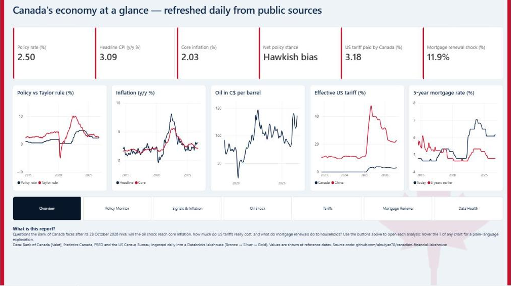

# Canadian Financial Lakehouse

**Forecasting Canadian core inflation and Bank of Canada policy-rate decisions from public macro-financial data.**

On **28 October 2026** the Bank of Canada raised its policy rate by 25 bp to **2.50 %** — its first hike since
July 2023 — citing an energy-price shock that pushed headline CPI to 3.1 % while core inflation stayed near 2 %.
This project builds the data pipeline and models needed to study exactly that kind of situation:

| | Question | Target |
|---|---|---|
| **A** | Where will core inflation be in 3, 6 and 12 months? | CPI-trim, CPI-median, headline CPI (y/y %) |
| **B** | Will the Bank cut, hold or hike over the next 1 and 3 months? | Direction of the policy rate {-1, 0, +1} |

> Version française en bas de page.

---

## Architecture

```
 Bank of Canada Valet ─┐
 Statistics Canada WDS ─┤
 US Census (tariffs)   ─┼─►  BRONZE              ─►  SILVER                 ─►  GOLD
 FRED (US data)        ─┘    raw API snapshots       tidy observations          monthly model table
                             + ingestion manifest    + quality report           real-time features + targets
                             data/bronze/            data/silver/               data/gold/
```

* **Registry-driven** – every series (38 today) is declared once in [`config/sources.yaml`](config/sources.yaml)
  with its source, frequency, aggregation rule and publication lag. Adding a series is a one-line change.
* **Bronze is immutable** – each run stores a new timestamped snapshot plus a SHA-256 manifest, so data
  revisions (StatCan revises GDP and LFS) are traceable.
* **Storage: Delta Lake (delta-rs)** – Silver and Gold are Delta tables written with the Rust `deltalake`
  library: ACID writes and **time travel** (`read_gold(version=3)` returns the exact table a past model was
  trained on) without a Spark cluster, which would be oversized for ~40 series.

### Data

| Domain | Series | Source |
|---|---|---|
| Policy & money market | Overnight target, CORRA | Valet |
| Yield curve | T-bills 1m–1y, GoC bonds 2y/5y/10y/long | Valet |
| Inflation | CPI-trim, CPI-median, CPI-common, CPI all-items index | Valet, StatCan |
| Expectations | Consensus 2–3y inflation, BOS share of firms expecting > 3 % | Valet |
| Commodities | BCPI total / energy / ex-energy, WTI | Valet, FRED |
| Real economy | Unemployment, employment, monthly GDP, LFS wage growth | StatCan, Valet |
| FX | USD/CAD (spliced with legacy noon rate to extend pre-2017), CEER | Valet |
| Money & credit | M2++ growth, 5-year mortgage rate | Valet |
| United States | Fed funds, Treasury 2y/10y, US CPI | FRED |
| Tariffs & trade policy | Effective US tariff rate on Canada / Mexico / China, trade-policy uncertainty index, US import prices from Canada | US Census, FRED |

### Avoiding look-ahead bias

A Gold row dated month *t* contains only what was **published by the end of month t**:

* each feature is shifted by its `release_lag_months` (September CPI is released in October, so it enters the
  October row; monthly GDP enters two months later);
* quarterly data describing a whole quarter is stamped on its last month; surveys (BOS, Consensus) on the
  month they are conducted;
* targets are built from reference-period values shifted **forward** (`y_cpi_trim_h6` = CPI-trim six months
  after *t*).

These rules are covered by unit tests ([`tests/test_pipeline.py`](tests/test_pipeline.py)). Remaining caveat:
the pipeline uses the *latest vintage* of revised series (GDP, LFS), not the vintage available at the time.

---

## Quick start

Requires [uv](https://docs.astral.sh/uv/) and Python 3.12+.

```bash
uv sync                      # install dependencies
export CENSUS_API_KEY=...    # free key for the tariff series: https://api.census.gov/data/key_signup.html
uv run cfl verify-sources    # check every series id against the source catalogs
uv run cfl run               # ingest → silver → gold
uv run cfl status            # last observation of each series
uv run cfl history           # Delta versions of Silver and Gold
uv run pytest                # tests (offline, synthetic payloads)
```

Without `CENSUS_API_KEY` the three tariff-rate series are reported as failed and skipped; the rest of the
pipeline still runs.

Outputs:

| File | Content |
|---|---|
| `data/silver/quality_report.csv` | coverage, gaps, dropped values per series |
| `data/gold/model_table_monthly/` (Delta, + `.csv`) | one row per month since 1990: raw features, derived features, targets |
| `data/gold/column_dictionary.csv` | role and meaning of every column |

## Power BI report

**[▶ Open the interactive report](https://app.powerbi.com/view?r=eyJrIjoiNGYwY2Q2YWYtNmRmNi00OTE0LTg5NTctYzU0NGE4ZDExNDNkIiwidCI6ImI5M2U3YTM0LWNlNDItNGUwNi1iMTI3LTQ0N2JmOGY1YzFiZCJ9)** (public, no sign-in)

[](https://app.powerbi.com/view?r=eyJrIjoiNGYwY2Q2YWYtNmRmNi00OTE0LTg5NTctYzU0NGE4ZDExNDNkIiwidCI6ImI5M2U3YTM0LWNlNDItNGUwNi1iMTI3LTQ0N2JmOGY1YzFiZCJ9)

An overview page and six analytical pages built on a star schema of Gold **BI marts** (at reference dates,
unlike the ML table which is aligned on publication dates), refreshed by the same daily job. Hover the **?**
of any chart for a plain-language explanation.

| Page | Question answered | Beyond a standard dashboard |
|---|---|---|
| Overview | Where does the economy stand today? | Six headline KPIs and mini-trends linking to each analysis |
| Policy monitor | Will the Bank hike, hold or cut? | Taylor rule with what-if parameters, market-implied path, hawkish/dovish scorecard |
| Signals & inflation | Which indicators push towards a hike or a cut? | Hawkish/dovish signal table with colour-coded readings |
| Oil shock | Is the 2026 energy shock spreading to core prices? | Oil priced in CAD, FX effect, measured energy → core pass-through lag |
| Tariffs | What does Canada actually pay, and who absorbs it? | Effective (paid) tariff vs Mexico/China, exporter price absorption |
| Mortgage renewal | What does a household renewing today pay? | Payment-shock simulator (semi-annual compounding, remaining amortization) |
| Data health | Can the numbers be trusted? | Freshness SLA per series, revisions, ingestion errors |

Model, DAX measures, theme and build guide: [`powerbi/`](powerbi/GUIDE.md). Every table and column is
documented once in [`config/bi_dictionary.yaml`](config/bi_dictionary.yaml) (dbt-style): the same file
writes the Unity Catalog comments and tags, renders [`docs/bi_data_dictionary.md`](docs/bi_data_dictionary.md)
(`uv run cfl docs`), and fails the tests if a column is left undocumented.

## Running on Databricks

The same pipeline is deployed to Databricks with a **Databricks Asset Bundle**
([`databricks.yml`](databricks.yml)): Unity Catalog schema and Volume, and a daily serverless Job —
4 parallel source ingestions → audit/freshness → change gate → incremental Silver `MERGE` → Gold — that
only rebuilds when a source published something new. Gold columns carry their descriptions as Unity
Catalog comments, and every run is a new Delta version. Setup: [`docs/databricks.md`](docs/databricks.md).

```bash
databricks bundle deploy -t prod && databricks bundle run cfl_daily_refresh -t prod
```

The bundle also deploys an **AI/BI dashboard** (policy monitor + data operations), defined as code in
[`dashboards/build_dashboard.py`](dashboards/build_dashboard.py), and an analysis notebook with one
question per cell ([`databricks/notebooks/05_analysis_charts.sql`](databricks/notebooks/05_analysis_charts.sql)).

## Repository layout

```
config/sources.yaml          series registry
config/bi_dictionary.yaml    data dictionary of the BI / ops tables (→ Unity Catalog comments, docs)
src/cfl/                     pipeline package (CLI: `cfl`)
  sources/{valet,statcan,fred,census}.py   API clients (fetch raw / parse)
  bronze.py  silver.py  gold.py            medallion layers
  storage.py                               Delta tables (delta-rs)
  bi.py                                    Power BI star schema (marts at reference dates)
  cli.py  databricks.py                    CLI; Unity Catalog publishing helpers
databricks/notebooks/        Databricks job tasks (01 Bronze, 01b audit, 02 Silver, 03–04 Gold), 05 analysis + examples/
databricks.yml               Databricks Asset Bundle (schema, volume, daily job, dashboard)
dashboards/                  AI/BI dashboard generated from Python (build_dashboard.py → .lvdash.json)
powerbi/                     DAX measures, theme, report build guide
tests/                       offline tests on recorded-format payloads
notebooks/
  01_data_discovery_series_exploration.ipynb   catalog exploration (15,906 Valet series → selection)
  02_series_metadata_verification.ipynb        coverage and quality checks of the selection
docs/data_dictionary_selected_series.md        financial meaning of the series
docs/databricks.md                             Databricks setup and deployment
docs/bi_data_dictionary.md                     generated data dictionary (uv run cfl docs)
discovery/                   raw catalog extraction and outputs
```

## Roadmap

- [x] Phase 1 — Data discovery: catalog exploration, series selection, quality checks
- [x] Phase 2 — Pipeline: multi-source ingestion, Bronze/Silver/Gold, real-time alignment, tests
- [x] Phase 2b — Databricks: Asset Bundle, Unity Catalog tables, daily serverless Job
- [x] Phase 2c — BI marts + Power BI report (7 pages, published) + Databricks AI/BI dashboard
- [ ] Phase 3 — Baselines: random walk, AR(p), Bank-target (2 %) benchmark; rolling-origin backtest
- [ ] Phase 4 — Models: penalised regression, gradient boosting; ordinal / multinomial model for problem B
- [ ] Phase 5 — Interpretation: SHAP, error analysis on 2008, 2020–22 and the 2026 energy shock
- [ ] Phase 6 — Presentation: dashboard + research-note style write-up

## Data sources and terms

* Bank of Canada Valet API — [terms of use](https://www.bankofcanada.ca/terms/)
* Statistics Canada Web Data Service — [Statistics Canada Open Licence](https://www.statcan.gc.ca/en/reference/licence)
* Federal Reserve Bank of St. Louis, FRED — [terms of use](https://fred.stlouisfed.org/legal/)
* US Census Bureau International Trade API — [terms of service](https://www.census.gov/data/developers/about/terms-of-service.html)

---

## Résumé en français

Ce projet prévoit **l'inflation fondamentale canadienne** (IPC-tronq, IPC-méd) à 3, 6 et 12 mois, ainsi que la
**direction du taux directeur** de la Banque du Canada (baisse, maintien, hausse), à partir de données publiques
de la Banque du Canada, de Statistique Canada et de la Réserve fédérale de St. Louis.

Le pipeline suit une architecture médaillon (Bronze → Silver → Gold) pilotée par un registre de séries. La table
finale est construite en **temps réel** : chaque variable est décalée selon son délai de publication, ce qui
évite toute fuite d'information future dans l'évaluation des modèles.

Lancement : `uv sync` puis `uv run cfl run`.
